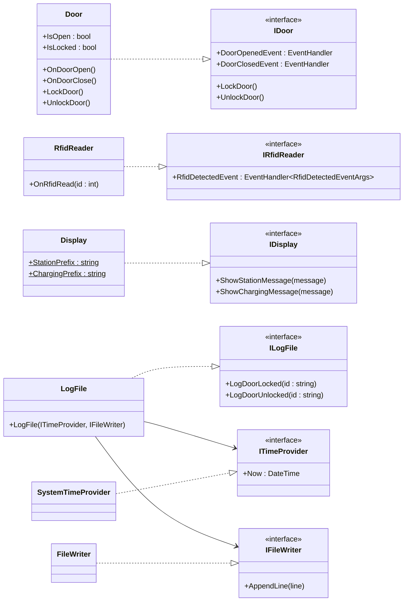
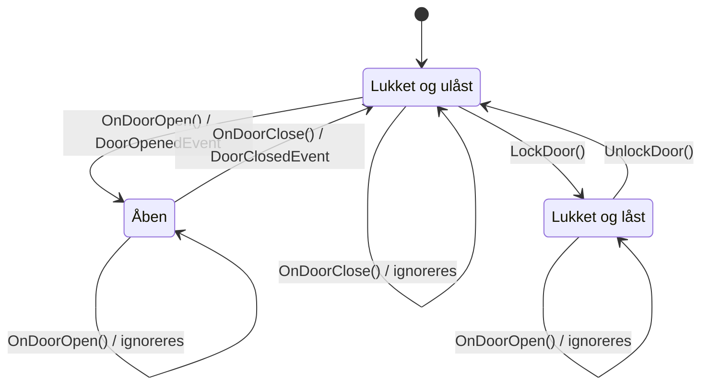
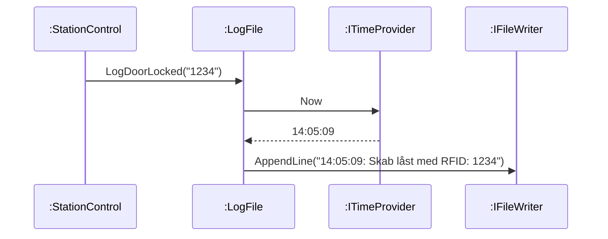

# Boundary-klasser: Door, RfidReader, Display og LogFile

[← Tilbage til dokumentationen](README.md)

Boundary-klasserne er systemets grænseflade mod hardware og omverden: lågen, RFID-læseren, displayet og logfilen. Hver af dem implementerer et interface fra `MobileChargingStation.Lib.Interfaces`. Controller-klasserne (`StationControl` og `ChargeControl`) kender kun interfacene og kan derfor testes med fakes i stedet for de rigtige klasser.

## Klassediagram



`OnDoorOpen()`, `OnDoorClose()` og `OnRfidRead()` står kun på de konkrete klasser, ikke på interfacene. De repræsenterer hardwaren, der registrerer en hændelse, og kaldes kun af konsolappen. Controllerne lytter på eventsene og har ikke brug for at kunne udløse dem.

## Door

`Door` simulerer lågen. `OnDoorOpen()` og `OnDoorClose()` svarer til, at hardwaren registrerer, at lågen åbnes eller lukkes, og omsættes til eventsene `DoorOpenedEvent` og `DoorClosedEvent` (Observer Pattern med C#-events). `StationControl` styrer låsen med `LockDoor()` og `UnlockDoor()`.



Door håndhæver selv to fysiske regler:

- En **låst** låge kan ikke åbnes. `OnDoorOpen()` ignoreres, og der fyres intet event.
- Et event fyres kun ved en reel tilstandsændring. At åbne en åben låge eller lukke en lukket låge giver intet event.

Dermed kan `StationControl` stole på, at den ikke modtager et "dør åbnet"-event, mens skabet er låst.

## RfidReader

`RfidReader` simulerer RFID-læseren. `OnRfidRead(int id)` fyrer `RfidDetectedEvent` med id'et i `RfidDetectedEventArgs`. Læseren har ingen logik; al vurdering af, om id'et er det rigtige, ligger i `StationControl`.

## Display

Displayet har to områder, jf. kravspecifikationen: brugerinstruktioner (`ShowStationMessage`), som bruges af `StationControl`, og ladestatus (`ShowChargingMessage`), som bruges af `ChargeControl`. De simuleres ved at skrive til konsollen med præfikserne `[Station]` og `[Ladning]`, så man kan se, hvilket område en besked hører til.

## LogFile

`LogFile` logger låsning og oplåsning som én linje pr. hændelse:

```
14:05:09: Skab låst med RFID: 1234
14:07:42: Skab låst op med RFID: 1234
```

De to svært kontrollerbare afhængigheder, systemuret og filsystemet, er indkapslet bag `ITimeProvider` og `IFileWriter`. `LogFile` sammensætter kun teksten. De rigtige implementeringer, `SystemTimeProvider` og `FileWriter`, er tynde wrappers om `DateTime.Now` og `File.AppendAllText`.



Tidsstemplet formateres med `CultureInfo.InvariantCulture`. Uden det bliver formatet `HH:mm:ss` til `14.05.09` på en maskine med dansk sprogindstilling, fordi `:` i .NET betyder "kulturens tidsseparator". Det er dækket af en test med `[SetCulture("da-DK")]`.

RFID-læseren leverer id'et som `int`, mens `ILogFile` tager en `string`. `StationControl` konverterer med `id.ToString()`, så logfilen ikke er bundet til, hvordan et RFID-id er repræsenteret.

## Test af boundary-klasserne

Hver klasse testes isoleret. Testcases er valgt med ZOMBIE, ækvivalensklasser (EP) og grænseværdier (BVA).

| Klasse | Testteknik |
| --- | --- |
| `Door` | Events fanges med lambda-handlers og tælles. Alle overgange i tilstandsdiagrammet testes, både dem der fyrer events, og dem der ignoreres. Zero: ingen events efter constructor og efter lås/oplås. One: ét event pr. åbning. Many: åbn/luk to gange giver to events af hver. Det testes også, at events uden abonnenter ikke kaster en exception, og at `sender` er døren. |
| `RfidReader` | Event-indhold og `sender` kontrolleres. Id'et testes med EP/BVA: `0`, `1`, `-1`, `1234`, `int.MaxValue` og `int.MinValue`. Many: to aflæsninger giver to events med det seneste id. |
| `Display` | Konsoloutput omdirigeres med `Console.SetOut(new StringWriter())` og sammenlignes eksakt, inkl. linjeskift. Det testes, at hvert område kun bruger sit eget præfiks, og at to beskeder kommer i den rigtige rækkefølge. Konsollen genskabes i `[TearDown]`, så andre tests ikke påvirkes. |
| `LogFile` | `ITimeProvider` og `IFileWriter` fakes med NSubstitute. Tidsstemplet testes med BVA (`00:00:00`, `23:59:59`), 24-timers format (`13:00:00`), foranstillede nuller (`09:08:07`), at dato og millisekunder ikke kommer med, og dansk kultur. Id'et testes med EP: `"0"`, `"-1"`, `"2147483647"` og tom streng. `Received.InOrder` sikrer rækkefølgen af linjer, og en test viser, at tiden aflæses ved hvert kald og ikke kun én gang. |

### Undtagelser fra coverage

`SystemTimeProvider` og `FileWriter` er markeret `[ExcludeFromCodeCoverage]`. De indeholder ingen logik, kun ét kald til henholdsvis systemuret og filsystemet. En unit test af dem ville teste .NET frem for vores kode, og den ville afhænge af det aktuelle klokkeslæt og af filsystemet på build-serveren. Al logik omkring logning ligger i `LogFile`, som er fuldt dækket.

## Designrefleksion

**Hardware-simulering i de konkrete klasser.** `OnDoorOpen()` og de tilsvarende metoder er en enkel måde at simulere hardware på, uden tråde eller timere. Prisen er, at metoderne kun findes på de konkrete klasser, så konsolappen skal holde referencer til `Door` og `RfidReader` og ikke kun til interfacene. Det er acceptabelt, fordi konsolappen er det eneste sted, der sætter systemet sammen.

**Door håndhæver selv de fysiske regler.** Reglen om, at en låst låge ikke kan åbnes, kunne også have ligget i `StationControl`. Vi har lagt den i `Door`, fordi det er en egenskab ved den fysiske låge og ikke ved styringen. Det gør `StationControl` simplere og betyder, at reglen kan testes for sig selv. Ulempen er, at `Door` ikke forhindrer, at en åben låge låses; det overlader vi til `StationControl`, som kun låser i tilstanden `Available`, hvor lågen er lukket.

**Ekstra interfaces for tid og fil.** `ITimeProvider` og `IFileWriter` giver to små interfaces og to wrapper-klasser ekstra. Til gengæld kan `LogFile` testes eksakt, også tidsstemplets format, uden at læse en rigtig fil eller afhænge af klokken. Uden dem ville testene enten være skrøbelige eller kun kunne tjekke, at "der står noget" i filen.

**Konsol i stedet for et rigtigt display.** `Display` skriver direkte til `Console`. Det er testbart med `Console.SetOut()`, men tests der omdirigerer konsollen, kan ikke køre parallelt med andre tests, der bruger konsollen. Det er ikke et problem her, fordi NUnit som standard ikke kører tests parallelt, men en `ITextOutput`-abstraktion ville have fjernet afhængigheden helt.
