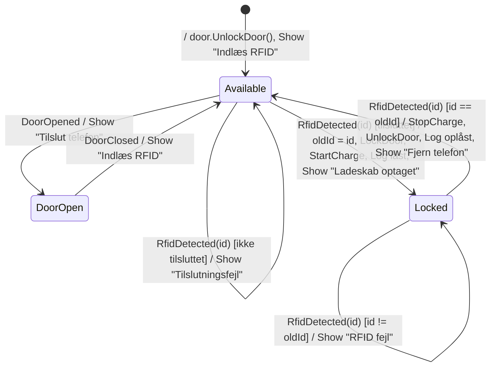
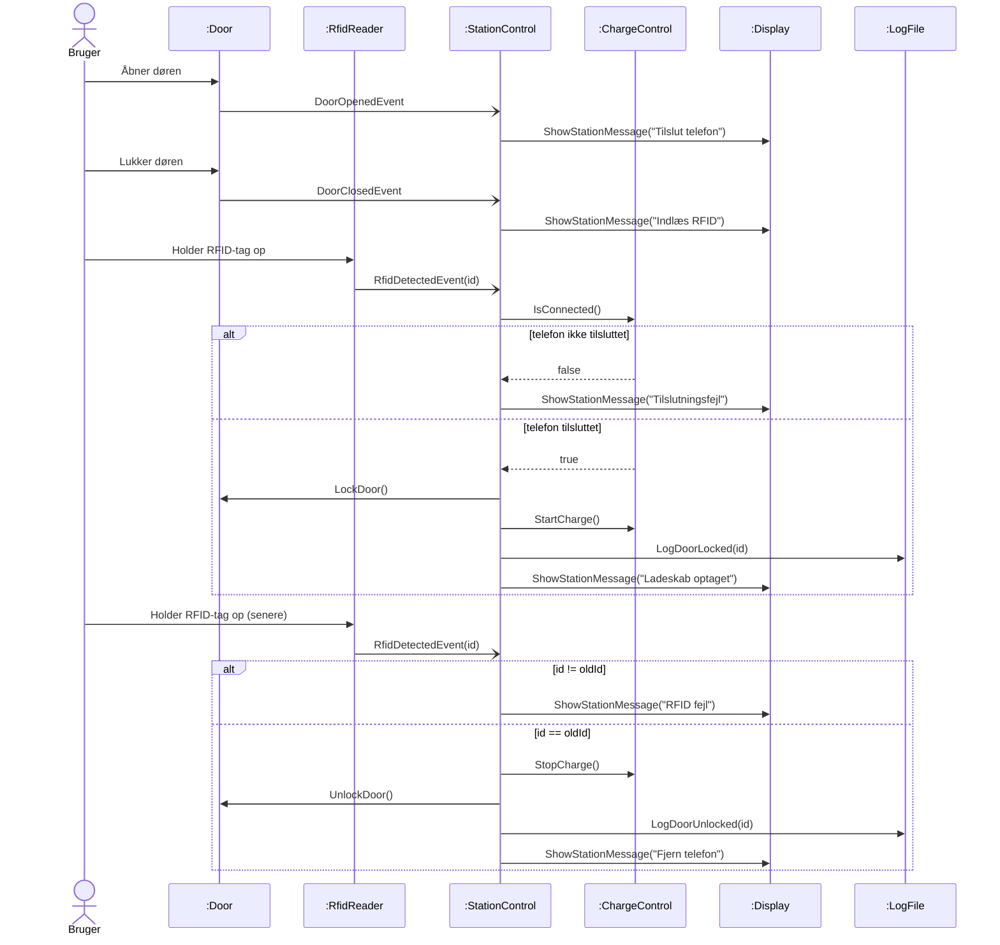
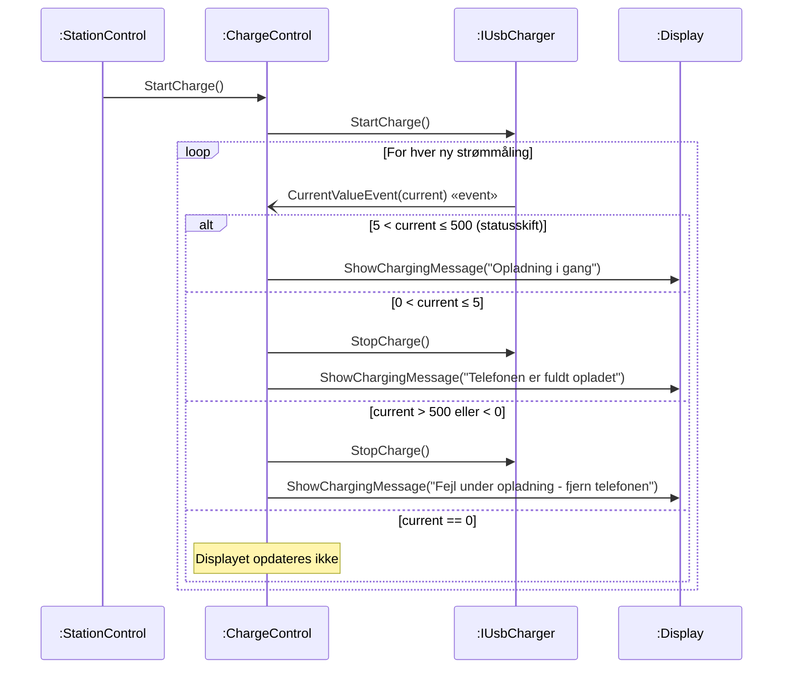
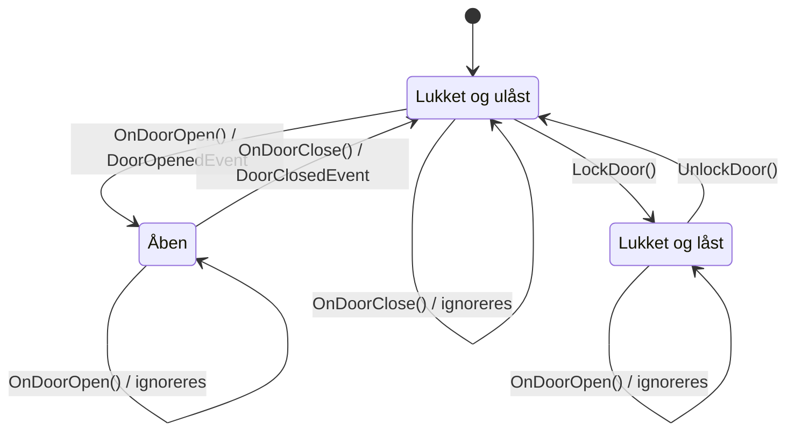
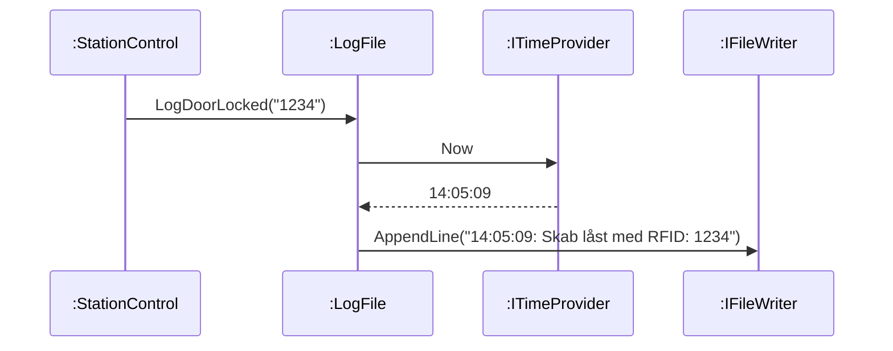
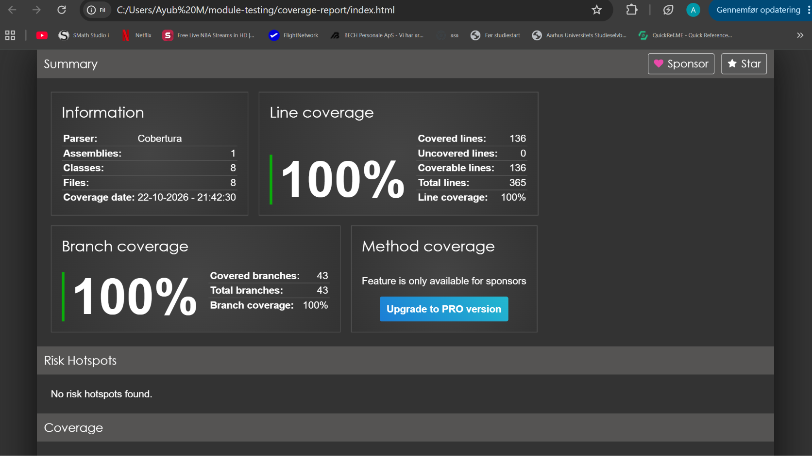
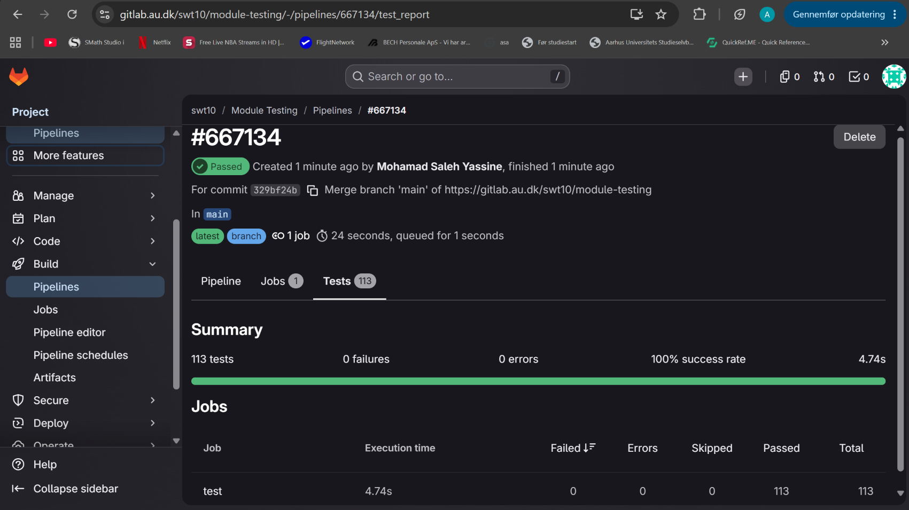

# Module Testing – Dokumentation

*SW4SWT Hand-in 2 - Gruppe 10*

## Indhold

1. [Overblik over løsningen](#1-overblik-over-løsningen)
2. [Design](#2-design)
3. [Teststrategi](#3-teststrategi)
4. [Coverage](#4-coverage)
5. [Continuous Integration](#5-continuous-integration)
6. [Refleksion over designet](#6-refleksion-over-designet)
7. [Arbejdsfordeling](#7-arbejdsfordeling)
8. [Refleksion over fælles repository og CI](#8-refleksion-over-fælles-repository-og-ci)

---

## 1. Overblik over løsningen

Solutionen består af tre projekter:

| Projekt | Indhold |
|---|---|
| `MobileChargingStation.Lib` | Alle klasser i ladeskabssystemet, opdelt i `Control` (logik), `Boundary` (simuleret hardware) og `Interfaces` |
| `MobileChargingStation.Lib.Test` | NUnit-tests af alle klasser i Lib, med NSubstitute som fakes |
| `MobileChargingStation.ConsoleApp` | Konsolapp, der samler systemet og lader brugeren simulere låge, telefon, RFID og kortslutning |

Systemet har to controllere. `StationControl` styrer ladeskabet som helhed: dør, RFID, log og brugerbeskeder. `ChargeControl` styrer opladningen og overvåger ladestrømmen. Hver hardwarekomponent (låge, RFID-læser, display, USB-lader) og logfilen er repræsenteret af en boundary-klasse bag et interface. Boundary-klasserne melder hændelser til controllerne via C# events (Observer Pattern), og controllerne får alle afhængigheder gennem constructoren. Systemet sættes sammen ét sted: i konsolappen.

---

## 2. Design

### 2.1 Klassediagram

```mermaid
classDiagram
    direction TB

    class StationControl {
        +ReadRfidMessage : string$
        +ConnectPhoneMessage : string$
        +ConnectionErrorMessage : string$
        +StationOccupiedMessage : string$
        +RfidErrorMessage : string$
        +RemovePhoneMessage : string$
        -_oldId : int
        +State : StationState
        -OnDoorOpened()
        -OnDoorClosed()
        -OnRfidDetected()
    }
    class StationState {
        <<enumeration>>
        Available
        DoorOpen
        Locked
    }
    class ChargeControl {
        +Status : ChargeStatus
        +IsConnected() bool
        +StartCharge()
        +StopCharge()
        -OnCurrentValueChanged()
    }
    class ChargeStatus {
        <<enumeration>>
        NotCharging
        FullyCharged
        Charging
        Error
    }

    class IDoor {
        <<interface>>
        +DoorOpenedEvent
        +DoorClosedEvent
        +LockDoor()
        +UnlockDoor()
    }
    class IRfidReader {
        <<interface>>
        +RfidDetectedEvent
    }
    class IChargeControl {
        <<interface>>
        +IsConnected() bool
        +StartCharge()
        +StopCharge()
    }
    class IDisplay {
        <<interface>>
        +ShowStationMessage(string)
        +ShowChargingMessage(string)
    }
    class ILogFile {
        <<interface>>
        +LogDoorLocked(string)
        +LogDoorUnlocked(string)
    }
    class IUsbCharger {
        <<interface>>
        +CurrentValueEvent
        +CurrentValue : double
        +Connected : bool
        +StartCharge()
        +StopCharge()
    }
    class ITimeProvider {
        <<interface>>
        +Now : DateTime
    }
    class IFileWriter {
        <<interface>>
        +AppendLine(string)
    }

    class Door {
        +OnDoorOpen()
        +OnDoorClose()
    }
    class RfidReader {
        +OnRfidRead(int)
    }

    StationControl --> StationState
    StationControl --> IDoor
    StationControl --> IRfidReader
    StationControl --> IChargeControl
    StationControl --> IDisplay
    StationControl --> ILogFile

    ChargeControl --> ChargeStatus
    ChargeControl ..|> IChargeControl
    ChargeControl --> IUsbCharger
    ChargeControl --> IDisplay

    Door ..|> IDoor
    RfidReader ..|> IRfidReader
    Display ..|> IDisplay
    LogFile ..|> ILogFile
    LogFile --> ITimeProvider
    LogFile --> IFileWriter
    SystemTimeProvider ..|> ITimeProvider
    FileWriter ..|> IFileWriter
    UsbChargerSimulator ..|> IUsbCharger
```



Controllerne (`StationControl` og `ChargeControl`) kender kun interfaces. Alle konkrete klasser og den simulerede hardware ligger bag dem og sættes sammen i konsolappen.

`OnDoorOpen()`, `OnDoorClose()` og `OnRfidRead()` står kun på de konkrete klasser, ikke på interfacene. De repræsenterer hardwaren, der registrerer en hændelse, og kaldes kun af konsolappen. Controllerne lytter på eventsene og har ikke brug for at kunne udløse dem.

### 2.2 StationControl

`StationControl` er controller-klassen for ladeskabet. Den reagerer på events fra døren og RFID-læseren og styrer dør, opladning, display og log ud fra tilstandsdiagrammet i opgaven (figur 4).

#### Tilstandsdiagram



Tilstandene er implementeret som en `enum` (`StationState`), og hver event-handler har en `switch` på den aktuelle tilstand.

**Events, der ikke står i diagrammet, ignoreres.** Det gælder RFID, mens døren er åben, at døren åbnes eller lukkes, mens skabet er låst, og at døren åbnes igen eller lukkes, når den allerede er i den tilstand. De tilfælde har egne tests, så det er dokumenteret, at de ikke ændrer noget.

Displaybeskederne ligger som `public const` på klassen, så testene refererer til konstanterne i stedet for at gentage teksterne.

#### Sekvensdiagram: låsning og oplåsning



### 2.3 ChargeControl og opladningssekvensen

`ChargeControl` er controller for opladningen. Den modtager kommandoer fra `StationControl` gennem `IChargeControl` og videregiver dem til `IUsbCharger`. Samtidig abonnerer den på `CurrentValueEvent` og klassificerer hver strømmåling efter kravspecifikationen:

| Målt strøm | Status | Handling |
|---|---|---|
| 0 mA | `NotCharging` | Displayet opdateres ikke |
| 0 < I ≤ 5 mA | `FullyCharged` | Opladning stoppes, "Telefonen er fuldt opladet" |
| 5 < I ≤ 500 mA | `Charging` | "Opladning i gang" |
| I > 500 mA | `Error` | Opladning stoppes straks, "Fejl under opladning - fjern telefonen" |

Sekvensdiagram for opladningen (ikke givet i opgaven):



**Designvalg:**

- **Displayet opdateres kun ved statusskift.** Laderen sender målinger løbende. Hvis displayet blev opdateret ved hvert event, ville det blive spammet med den samme besked. `ChargeControl` husker derfor sin seneste status og reagerer kun, når den ændrer sig.
- **0 mA rører ikke displayet.** Når laderen stoppes ved "fuldt opladet", falder strømmen til 0. Ryddede vi displayet her, ville brugeren aldrig se, at telefonen er opladet.
- **Negativ strøm behandles som fejl.** Kravspecifikationen dækker ikke negative værdier. En negativ måling tyder på en sensorfejl, og det sikreste er at stoppe opladningen.
- **Grænserne og beskederne er `public const`**, så testene refererer til de samme værdier som koden.

### 2.4 Boundary-klasser: Door, RfidReader, Display og LogFile

Boundary-klasserne er systemets grænseflade mod hardware og omverden. Hver af dem implementerer et interface fra `MobileChargingStation.Lib.Interfaces`.

#### Door

`Door` simulerer lågen. `OnDoorOpen()` og `OnDoorClose()` svarer til, at hardwaren registrerer, at lågen åbnes eller lukkes, og omsættes til eventsene `DoorOpenedEvent` og `DoorClosedEvent`. `StationControl` styrer låsen med `LockDoor()` og `UnlockDoor()`.



Door håndhæver selv to fysiske regler:

- En **låst** låge kan ikke åbnes. `OnDoorOpen()` ignoreres, og der fyres intet event.
- Et event fyres kun ved en reel tilstandsændring. At åbne en åben låge eller lukke en lukket låge giver intet event.

Dermed kan `StationControl` stole på, at den ikke modtager et "dør åbnet"-event, mens skabet er låst.

#### RfidReader

`RfidReader` simulerer RFID-læseren. `OnRfidRead(int id)` fyrer `RfidDetectedEvent` med id'et i `RfidDetectedEventArgs`. Læseren har ingen logik; al vurdering af, om id'et er det rigtige, ligger i `StationControl`.

#### Display

Displayet har to områder, jf. kravspecifikationen: brugerinstruktioner (`ShowStationMessage`), som bruges af `StationControl`, og ladestatus (`ShowChargingMessage`), som bruges af `ChargeControl`. De simuleres ved at skrive til konsollen med præfikserne `[Station]` og `[Ladning]`, så man kan se, hvilket område en besked hører til.

#### LogFile

`LogFile` logger låsning og oplåsning som én linje pr. hændelse:

```
14:05:09: Skab låst med RFID: 1234
14:07:42: Skab låst op med RFID: 1234
```

De to svært kontrollerbare afhængigheder, systemuret og filsystemet, er indkapslet bag `ITimeProvider` og `IFileWriter`. `LogFile` sammensætter kun teksten. De rigtige implementeringer, `SystemTimeProvider` og `FileWriter`, er tynde wrappers om `DateTime.Now` og `File.AppendAllText`.



Tidsstemplet formateres med `CultureInfo.InvariantCulture`. Uden det bliver formatet `HH:mm:ss` til `14.05.09` på en maskine med dansk sprogindstilling, fordi `:` i .NET betyder "kulturens tidsseparator". Det er dækket af en test med `[SetCulture("da-DK")]`.

RFID-læseren leverer id'et som `int`, mens `ILogFile` tager en `string`. `StationControl` konverterer med `id.ToString()`, så logfilen ikke er bundet til, hvordan et RFID-id er repræsenteret.

### 2.5 Hvorfor designet er testbart

- **Al hardware og alle svært kontrollerbare afhængigheder er indkapslet bag interfaces.** Det gælder låge, RFID-læser, display, USB-lader, systemuret og filsystemet. Ingen klasse med logik taler direkte med konsollen, uret eller en fil.
- **Constructor injection.** Hver klasse får sine afhængigheder gennem constructoren som interfaces, så testene kan give den NSubstitute-fakes i stedet for rigtige objekter. Hver klasse testes derfor helt isoleret.
- **Events giver løs kobling.** `StationControl` kender ikke `Door`, kun `IDoor`, og `ChargeControl` kender kun `IUsbCharger`. Testene udløser events direkte på fakes med `Raise.Event()` og `Raise.EventWith(...)` og kan dermed simulere enhver rækkefølge af hændelser.
- **Tilstand er synlig.** `StationControl.State` og `ChargeControl.Status` er offentlige properties, så testene kan verificere tilstanden efter hver transition.
- **Ingen tråde eller timere i vores egen kode.** Alt sker synkront som reaktion på events, så testene er deterministiske og hurtige. Den eneste timer ligger i den udleverede `UsbChargerSimulator`, som kun bruges i konsolappen.

---

## 3. Teststrategi

### 3.1 Overordnet tilgang

Alle klasser i `MobileChargingStation.Lib` er unit-testet isoleret med fakes for alle afhængigheder. Testene følger Arrange–Act–Assert, hver testklasse har én `[SetUp]`, der opretter fakes og "unit under test", og `[TestCase]` bruges til parameteriserede tests af grænseværdier.

Fakes laves med NSubstitute. De vigtigste teknikker:

| Teknik | Brug |
|---|---|
| `Raise.Event()` / `Raise.EventWith(...)` | Udløse events fra dør, RFID-læser og USB-lader |
| `Received()` / `DidNotReceive()` | Verificere, at controllerne kalder (eller ikke kalder) dør, lader, display og log |
| `Received.InOrder(...)` | Verificere rækkefølgen af kald, fx i hele brugsscenariet |
| `.Returns(...)` | Styre svar fra fakes, fx `IsConnected()` og `ITimeProvider.Now` |
| `Console.SetOut(new StringWriter())` | Fange konsoloutput i test af `Display` |

Testcases er valgt med boundary value analysis (BVA), equivalence partitioning (EP) og ZOMBIE (Zero, One, Many, Boundaries, Interfaces, Exceptions).

### 3.2 ChargeControl

Testet med BVA på de tre grænser 0, 5 og 500 mA. Hver grænse testes præcis på og lige over, og hvert interval får en midtværdi (EP):

| Partition | Testværdier |
|---|---|
| 0 mA | 0 |
| 0 < I ≤ 5 | 0.001, 2.5, 5.0 |
| 5 < I ≤ 500 | 5.001, 250, 500.0 |
| I > 500 | 500.001, 10000 |
| I < 0 (uden for spec) | -0.001, -100 |

ZOMBIE er brugt til sekvenser: gentagne målinger med samme status (Many) giver kun én opdatering af displayet, og skift mellem statusser (fx opladning → fuldt opladet → 0 mA) er testet i rækkefølge. Videregivelsen af `IsConnected()`, `StartCharge()` og `StopCharge()` til `IUsbCharger` er testet for sig.

### 3.3 StationControl

`StationControl` testes med fakes af alle fem afhængigheder. Den offentlige `State`-property gør det muligt at teste tilstanden direkte.

- **Alle transitioner** i tilstandsdiagrammet har mindst én test af både tilstanden bagefter og handlingerne på transitionen.
- **Alle udefinerede events** (5 kombinationer af tilstand og event) har en test, der viser, at de ignoreres.
- **BVA/EP på RFID-id:** id'et logges korrekt for `int.MinValue`, -1, 0, 1 og `int.MaxValue`, og et forkert id lige under og lige over det rigtige afvises.
- **ZOMBIE:** forkert id efterfulgt af rigtigt id (Many), og to brugere efter hinanden, hvor det gamle id ikke længere virker.
- **Hele brugsscenariet** fra figur 3 testes som én sekvens med `Received.InOrder()`.

### 3.4 Boundary-klasserne

| Klasse | Testteknik |
| --- | --- |
| `Door` | Events fanges med lambda-handlers og tælles. Alle overgange i tilstandsdiagrammet testes, både dem der fyrer events, og dem der ignoreres. Zero: ingen events efter constructor og efter lås/oplås. One: ét event pr. åbning. Many: åbn/luk to gange giver to events af hver. Det testes også, at events uden abonnenter ikke kaster en exception, og at `sender` er døren. |
| `RfidReader` | Event-indhold og `sender` kontrolleres. Id'et testes med EP/BVA: `0`, `1`, `-1`, `1234`, `int.MaxValue` og `int.MinValue`. Many: to aflæsninger giver to events med det seneste id. |
| `Display` | Konsoloutput omdirigeres med `Console.SetOut(new StringWriter())` og sammenlignes eksakt, inkl. linjeskift. Det testes, at hvert område kun bruger sit eget præfiks, og at to beskeder kommer i den rigtige rækkefølge. Konsollen genskabes i `[TearDown]`, så andre tests ikke påvirkes. |
| `LogFile` | `ITimeProvider` og `IFileWriter` fakes med NSubstitute. Tidsstemplet testes med BVA (`00:00:00`, `23:59:59`), 24-timers format (`13:00:00`), foranstillede nuller (`09:08:07`), at dato og millisekunder ikke kommer med, og dansk kultur. Id'et testes med EP: `"0"`, `"-1"`, `"2147483647"` og tom streng. `Received.InOrder` sikrer rækkefølgen af linjer, og en test viser, at tiden aflæses ved hvert kald og ikke kun én gang. |

---

## 4. Coverage

Coverage måles i pipelinen med **coverlet** og samles til en HTML-rapport med **ReportGenerator**. Rapporten ligger som artifact på hvert pipeline-job (`coverage-report/index.html`), og coverage-procenten vises direkte i GitLab ved pipelines og merge requests.

**Resultat:** 100 % line coverage og 100 % branch coverage for alle klasser, vi selv har skrevet.



**Hvordan vi har brugt coverage:** Rapporten blev brugt aktivt under udviklingen. Gule markeringer viste forgreninger, der kun var testet den ene vej, og det pegede direkte på manglende testcases. Rapporten viste også, at den eneste klasse under 100 % branch coverage var den udleverede `UsbChargerSimulator` (84,6 %), hvilket førte til beslutningen om at undtage den.

**Undtagelser** (markeret med `[ExcludeFromCodeCoverage]`):

- **`UsbChargerSimulator`**: udleveret kode, som ifølge opgaven ikke er vores opgave at teste. Den indeholder desuden en uopnåelig gren: `else if (!Connected)` kan aldrig være falsk, fordi de foregående betingelser allerede har udelukket `Connected == true`.
- **`SystemTimeProvider` og `FileWriter`**: de indeholder ingen logik, kun ét kald til henholdsvis systemuret og filsystemet. En unit test af dem ville teste .NET frem for vores kode, og den ville afhænge af det aktuelle klokkeslæt og af filsystemet på build-serveren. Al logik omkring logning ligger i `LogFile`, som er fuldt dækket.

**Begrænsning:** 100 % coverage betyder kun, at alle linjer og grene er kørt – ikke at de er testet med de rigtige værdier. Derfor har vi kombineret coverage med BVA, EP og ZOMBIE.

---

## 5. Continuous Integration

Pipelinen er defineret i én fil, `.gitlab-ci.yml`, og kører på hver push til alle branches:

1. `dotnet restore` og `dotnet build` på `mcr.microsoft.com/dotnet/sdk:10.0`
2. `dotnet test` med JUnit-logger og coverlet
3. ReportGenerator laver HTML-rapport og en samlet Cobertura-fil

**Hvor resultaterne findes i GitLab:**

- **Testresultater:** fanen *Tests* på hver pipeline
- **Coverage-procent:** ved siden af jobbet og i merge requests
- **Coverage-rapport:** jobbets *Artifacts* → `coverage-report/index.html`

**Arbejdsgang:** Hver opgave blev lavet på sin egen feature-branch (`feature/...`) og merget til `main` via merge request med Gits default merge-strategi (ingen squash eller rebase), så den fulde historik er bevaret. En merge request blev først merget, når pipelinen var grøn.



---

## 6. Refleksion over designet

### Overordnet arkitektur

**Constructor injection af interfaces.** Controllerne får alle afhængigheder gennem constructoren som interfaces. Det gør dem fuldt testbare uden hardware, fil eller konsol, og hver afhængighed kan erstattes af en fake. Ulempen er en constructor med fem parametre i `StationControl` og mere opsætning i konsolappen, men det er en lille pris for at kunne teste alt isoleret.

**Events i stedet for polling.** Dør, RFID-læser og USB-lader melder selv ændringer via C# events. Det giver løs kobling: boundary-klasserne kender ikke controllerne, og der er ikke behov for tråde eller timere. Ulempen er, at flowet er sværere at følge i koden end almindelige metodekald, hvilket sekvensdiagrammerne skal hjælpe med.

**Ansvarsfordeling mellem controllere.** `StationControl` ved ikke noget om ladestrøm. Den spørger kun `IChargeControl`, om telefonen er tilsluttet, og starter og stopper opladning. Overvågningen af strømmen ligger i `ChargeControl`, som skriver i displayets andet område. Det holder `StationControl` simpel og gør de to controllere uafhængige af hinanden i testene. `ChargeControl` er desuden adskilt fra boundary-klassen `UsbCharger`, så logikken om strømgrænser kan testes uden den simulerede hardware.

**Mange små interfaces.** Ét interface pr. komponent giver flere filer og mere "boilerplate", men gør hver klasse let at teste og at udskifte – fx kan `UsbChargerSimulator` erstattes af en rigtig USB-lader uden ændringer i controllerne.

### StationControl

**Tilstandsmaskine med enum og switch.** Tilstandene er en `enum`, og hver event-handler har en `switch` på den aktuelle tilstand. Det ligger tæt på tilstandsdiagrammet og er nemt at teste transition for transition. Alternativet, State Pattern med en klasse pr. tilstand, blev fravalgt, fordi der kun er tre tilstande og tre events, så det ville give flere klasser uden at gøre koden klarere.

**Beskeder som `public const`.** Testene refererer til konstanterne i stedet for at gentage tekster, så en ændret formulering ikke bryder testene. Ulempen er, at testene ikke fanger, hvis en konstant ved en fejl får en forkert tekst.

### ChargeControl

**Statusskift frem for hvert event.** At opdatere displayet kun ved statusskift kræver, at `ChargeControl` husker sin seneste status, hvilket gør klassen en smule mere kompleks. Til gengæld undgås gentagne, identiske beskeder, og det er nemt at teste med en Many-test.

### Boundary-klasser

**Hardware-simulering i de konkrete klasser.** `OnDoorOpen()` og de tilsvarende metoder er en enkel måde at simulere hardware på, uden tråde eller timere. Prisen er, at metoderne kun findes på de konkrete klasser, så konsolappen skal holde referencer til `Door` og `RfidReader` og ikke kun til interfacene. Det er acceptabelt, fordi konsolappen er det eneste sted, der sætter systemet sammen.

**Door håndhæver selv de fysiske regler.** Reglen om, at en låst låge ikke kan åbnes, kunne også have ligget i `StationControl`. Vi har lagt den i `Door`, fordi det er en egenskab ved den fysiske låge og ikke ved styringen. Det gør `StationControl` simplere og betyder, at reglen kan testes for sig selv. Ulempen er, at `Door` ikke forhindrer, at en åben låge låses; det overlader vi til `StationControl`, som kun låser i tilstanden `Available`, hvor lågen er lukket.

**Ekstra interfaces for tid og fil.** `ITimeProvider` og `IFileWriter` giver to små interfaces og to wrapper-klasser ekstra. Til gengæld kan `LogFile` testes eksakt, også tidsstemplets format, uden at læse en rigtig fil eller afhænge af klokken. Uden dem ville testene enten være skrøbelige eller kun kunne tjekke, at "der står noget" i filen.

### Hvad vi ville gøre anderledes

**Konsol i stedet for et rigtigt display.** `Display` skriver direkte til `Console`. Det er testbart med `Console.SetOut()`, men tests der omdirigerer konsollen, kan ikke køre parallelt med andre tests, der bruger konsollen. Det er ikke et problem her, fordi NUnit som standard ikke kører tests parallelt, men en `ITextOutput`-abstraktion ville have fjernet afhængigheden helt.


---

## 7. Arbejdsfordeling

| Medlem | Opgaver |
|---|---|
| Mohamad | Repo, CI-pipeline, interfaces, `ChargeControl` + tests, `Program.cs`, dokumentation af ChargeControl, coverage og CI |
| Ayub | `StationControl` + tests, klasse-, tilstands- og sekvensdiagrammer, designrefleksion |
| Mohamed | `Door`, `RfidReader`, `Display`, `LogFile` + tests, rod-README |

**Hvordan:** Først blev repo, pipeline og alle interfaces lavet og lagt på `main`. Derefter blev resten fordelt efter klasser, så hver person havde ansvar for kode, tests og dokumentation af sine egne klasser. Alle arbejdede på deres egen feature-branch (`feature/charge-control`, `feature/station-control`, `feature/boundary`) og mergede til `main` via merge requests. Til sidst blev dokumentationen samlet i én fil, og de fælles afsnit blev skrevet sammen.

**Hvorfor:** Når interfaces lå på `main` fra starten, kunne alle arbejde parallelt. `StationControl` kunne fx testes færdigt med NSubstitute-fakes af `IDoor` og `IRfidReader`, før de rigtige `Door` og `RfidReader` fandtes. Fordeling efter klasser gav hver person en afgrænset opgave, og det sikrede, at alle har bidraget med både kode, tests og dokumentation.

**Fordele:**
- Tydeligt ejerskab. Alle vidste, hvilke filer de skulle arbejde i.
- Få merge-konflikter. De tre feature-branches kunne merges ind i `main` uden konflikter, fordi de rørte hver sine filer.
- Interfaces som fælles kontrakt gjorde, at klasserne passede sammen ved første merge.

**Ulemper:**
- Opgaverne var forskellige af natur og derfor svære at sammenligne. Nogle bestod af én klasse med meget logik, andre af flere mindre klasser eller af infrastruktur og opsætning. Det gjorde det svært at vurdere på forhånd, hvor lang tid hver del ville tage.
- Man kender mindre til de andres kode, fordi hver person primært har arbejdet i sine egne klasser.
- Dokumentationen blev først skrevet i separate filer og skulle bagefter samles. Det gav ekstra arbejde og en periode, hvor der lå flere versioner af samme tekst.

**Hvad vi ville gøre anderledes:** Aftale strukturen for `docs/README.md` fra starten, så alle skriver direkte i den rigtige fil, og lade en anden person reviewe hver merge request, så alle kender mere af koden.

---

## 8. Refleksion over fælles repository og CI

**Observationer:**
- Pipelinen blev sat op som noget af det første, så alle commits på alle branches er bygget og testet. Testresultater og coverage kunne ses direkte på GitLab ved hver pipeline og merge request.
- Det udleverede skelet kompilerede ikke, fordi `IDoor`, `IChargeControl` og variablerne i `Program.cs` manglede. Det blev løst ved at lave interfaces og en byggende solution først, så pipelinen kunne blive grøn fra starten.
- Det første push gik til det udleverede repo i stedet for gruppens eget (403-fejl), og gruppens repo havde en README fra oprettelsen. Historikkerne skulle derfor flettes med `--allow-unrelated-histories`.
- Mod slutningen arbejdede flere direkte på `main` samtidig med dokumentationen. Det gav afviste pushes ("rejected – fetch first"), fordi en anden havde pushet imens. Løsningen var altid at køre `git pull origin main` lige før `git push`.
- Fejl i filstrukturen, fx en billedmappe i `docs/docs/images` og en dublet af `docs/README.md`, blev opdaget, fordi alle løbende hentede og kiggede på hinandens ændringer.

**Fordele:**
- Fejl blev fanget før merge. En merge request blev først merget, når pipelinen var grøn.
- Coverage-rapporten var synlig for alle og viste konkret, hvilke grene der manglede tests.
- Merge requests og commit-historikken gav overblik over, hvem der havde lavet hvad.
- Gits default merge-strategi bevarede hele historikken, så alle bidrag er synlige.

**Ulemper:**
- Ventetid på pipelinen ved hver push, især fordi de udleverede tests af `UsbChargerSimulator` bruger timere og tager flere sekunder.
- Branches og merge requests giver ekstra overhead ved små ændringer som rettelser i dokumentationen.
- Git kræver disciplin. Tastefejl i branchnavne, glemte pulls og en lokal branch, der fulgte det forkerte remote, kostede tid undervejs.