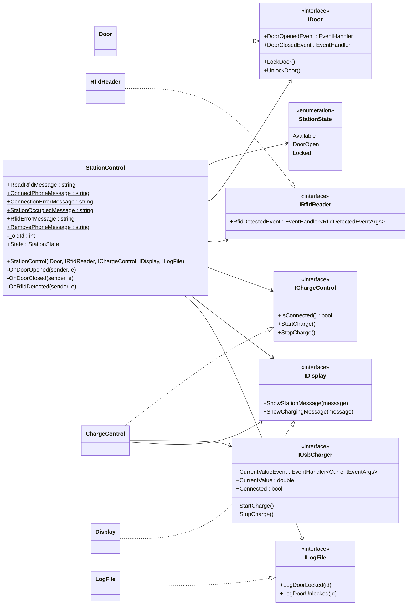
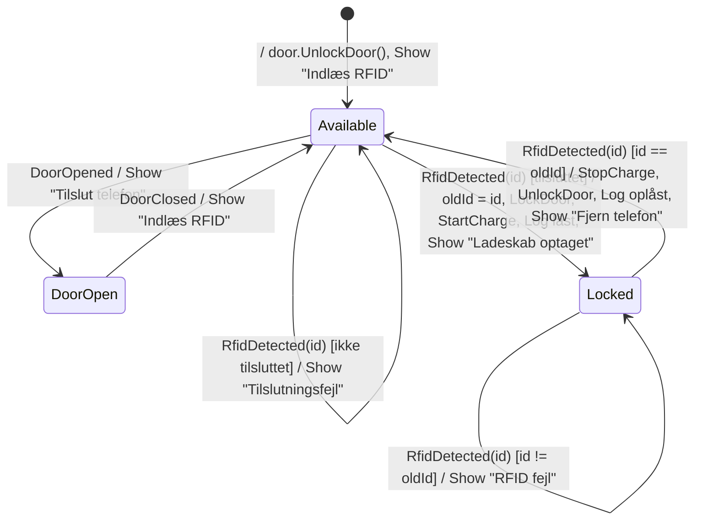
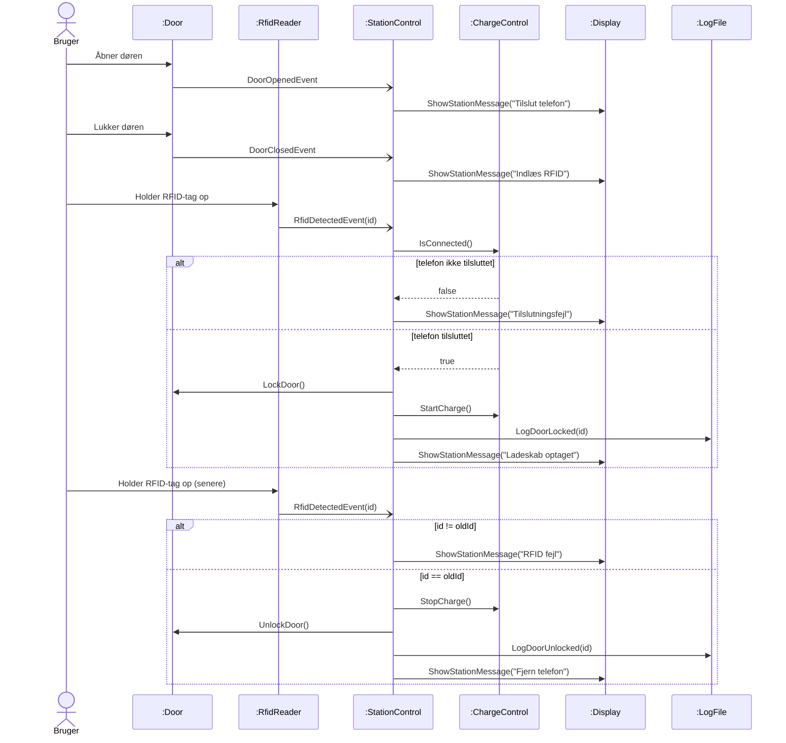

# StationControl

`StationControl` er controller-klassen for ladeskabet. Den reagerer på events fra døren og RFID-læseren og styrer dør, opladning, display og log ud fra tilstandsdiagrammet i opgaven (figur 4).

## Klassediagram

`StationControl` kender kun interfaces. Alle konkrete klasser og hardwaren (dør, RFID-læser, USB-lader, konsol og fil) ligger bag dem og sættes sammen i konsolappen.

## Tilstandsdiagram

Events, der ikke står i diagrammet, ignoreres. Det gælder RFID, mens døren er åben, at døren åbnes eller lukkes, mens skabet er låst, og at døren åbnes igen eller lukkes, når den allerede er i den tilstand. De tilfælde har egne tests, så det er dokumenteret, at de ikke ændrer noget.

## Sekvensdiagram: låsning og oplåsning

## Test af StationControl

`StationControl` testes isoleret med NSubstitute-fakes af alle fem afhængigheder. Events fra døren og RFID-læseren udløses med `Raise.Event()` og `Raise.EventWith(...)`, og kaldene på dør, lader, display og log verificeres med `Received()`, `DidNotReceive()` og `Received.InOrder()`. Den offentlige `State`-property gør det muligt at teste tilstanden direkte.

Testcases er valgt sådan:

- **Alle transitioner** i tilstandsdiagrammet har mindst én test af både tilstanden bagefter og handlingerne på transitionen.
- **Alle udefinerede events** (5 kombinationer af tilstand og event) har en test, der viser, at de ignoreres.
- **BVA/EP på RFID-id**: id'et logges korrekt for `int.MinValue`, -1, 0, 1 og `int.MaxValue`, og et forkert id lige under og lige over det rigtige afvises.
- **ZOMBIE**: forkert id efterfulgt af rigtigt id (Many), og to brugere efter hinanden, hvor det gamle id ikke længere virker.
- **Hele brugsscenariet** fra figur 3 testes som én sekvens med `Received.InOrder()`.

## Designrefleksion (udkast)

**Constructor injection af interfaces.** `StationControl` får alle afhængigheder gennem constructoren som interfaces. Det gør klassen fuldt testbar uden hardware, fil eller konsol, og hver afhængighed kan erstattes af en fake. Ulempen er en constructor med fem parametre og mere opsætning i konsolappen, men det er en lille pris for at kunne teste alt isoleret.

**Events i stedet for polling.** Dør og RFID-læser melder selv ændringer via C# events (Observer Pattern). Det giver løs kobling: boundary-klasserne kender ikke `StationControl`, og der er ikke behov for tråde eller timere. Ulempen er, at flowet er sværere at følge i koden end almindelige metodekald, hvilket diagrammerne ovenfor skal hjælpe med.

**Tilstandsmaskine med enum og switch.** Tilstandene er en `enum`, og hver event-handler har en `switch` på den aktuelle tilstand. Det ligger tæt på tilstandsdiagrammet og er nemt at teste transition for transition. Alternativet, State Pattern med en klasse pr. tilstand, blev fravalgt, fordi der kun er tre tilstande og tre events, så det ville give flere klasser uden at gøre koden klarere.

**Beskeder som `public const`.** Displaybeskederne ligger som konstanter på klassen. Testene refererer til konstanterne i stedet for at gentage tekster, så en ændret formulering ikke bryder testene.

**Ansvarsfordeling mellem controllere.** `StationControl` ved ikke noget om ladestrøm. Den spørger kun `IChargeControl`, om telefonen er tilsluttet, og starter og stopper opladning. Selve overvågningen af strømmen ligger i `ChargeControl`, som skriver i displayets andet område. Det holder `StationControl` simpel og gør de to controllere uafhængige af hinanden i testene.
